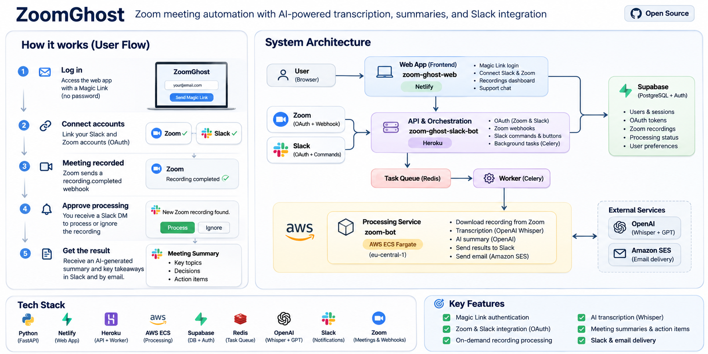
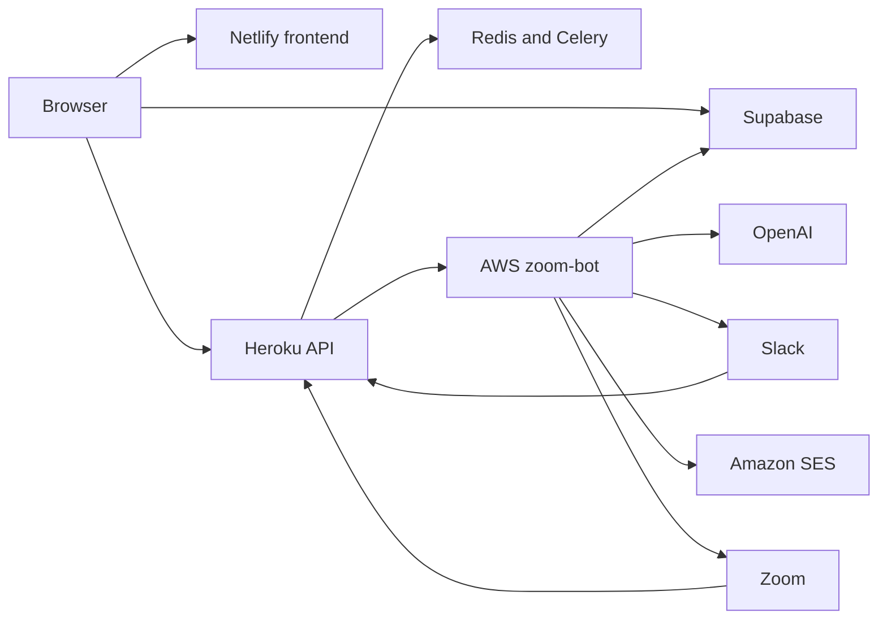

# ZoomGhost

ZoomGhost turns a finished Zoom cloud recording into a meeting summary. When a recording is ready, you get a Slack message and choose whether to process it. OpenAI transcribes and summarizes the recording on AWS, and the result comes back in Slack and, when an email address is on file, by email.

<p align="center">
  
</p>

## About ZoomGhost

Zoom recordings are easy to collect and hard to review. ZoomGhost watches for a completed cloud recording, asks in Slack before doing any further work, and returns a written summary of the meeting.

Zoom sends a `recording.completed` webhook to the Heroku API. If that Zoom host is already linked to a ZoomGhost user, the recording metadata is stored and a Celery worker sends a Slack direct message with **Process** and **Ignore** buttons.

**Process** sends the stored download URL to the AWS service. That service downloads the file, transcribes it with OpenAI Whisper, and summarizes it with `gpt-3.5-turbo`. The summary is posted to the Slack channel from the button click. When Supabase has an email for the Zoom host, Amazon SES sends the same summary.

**Ignore** leaves the recording unprocessed. Slack settings for auto-processing, duration, and delivery are saved, and the recording pipeline does not read them. Recordings shorter than 15 seconds are stored as `too_short` and still produce the Slack prompt.

This is an existing system released as open source. The recording path above is implemented. A few extra routes and stored preferences are described in the [architecture notes](docs/architecture.md).

## Key features

- Magic-link sign-in through Supabase Auth.
- Per-user Zoom and Slack OAuth, with tokens stored in Supabase.
- Zoom `recording.completed` webhooks, including Zoom's URL validation handshake.
- A Slack message that asks whether to process each recording.
- Background transcription and summarization on AWS ECS Fargate.
- Summary delivery to Slack, and email through Amazon SES when a host email exists.
- A dashboard list of the signed-in user's recordings.
- A support form that writes to Supabase.
- A Slack settings modal that stores notification preferences.

## How it works

1. Sign in with a magic link from Supabase Auth.
2. Connect a Zoom account and a Slack account.
3. Finish a Zoom meeting that has cloud recording enabled.
4. ZoomGhost receives the completed recording and stores it for the linked user.
5. A Slack direct message asks whether to process that recording.
6. Choose **Process** to send it to AWS, or **Ignore** to leave it unprocessed.
7. AWS transcribes the audio and writes a summary with OpenAI.
8. The summary arrives in Slack, and by email when an address is stored for the host.

## Architecture

ZoomGhost is three applications in one repository. They share Supabase for sign-in and data.



| Application | Role | Hosting |
| --- | --- | --- |
| `zoom-ghost-web` | Static site for sign-in, account connections, the recording list, and the support form | Netlify |
| `zoom-ghost-slack-bot` | FastAPI API, Zoom and Slack OAuth, webhooks, Celery, and Redis | Heroku |
| `zoom-bot` | Downloads the recording, calls OpenAI, and delivers the summary | AWS ECS Fargate |

The browser calls Supabase and the Heroku API. Heroku calls AWS after **Process** is clicked. The full diagram is in [docs/diagrams/system-architecture.md](docs/diagrams/system-architecture.md).

## Technology stack

**Frontend.** HTML, CSS, Tailwind from a CDN, and the Supabase JavaScript client. Runtime configuration is `config.js`.

**Backend and orchestration.** FastAPI, Uvicorn, Celery, and Redis. The Heroku `Procfile` runs a web process and a worker.

**AI processing.** FastAPI in Docker, ffmpeg, OpenAI `whisper-1` for transcription, and `gpt-3.5-turbo` for summaries.

**Database and authentication.** Supabase Auth and PostgreSQL. The browser uses the anon key. Heroku uses the service role key. The AWS service uses `SUPABASE_KEY`.

**Cloud infrastructure.** Netlify, Heroku, Amazon ECR, ECS Fargate, an Application Load Balancer, Secrets Manager, and Amazon SES. The processing service and the SES client use `eu-central-1`.

**External integrations.** Zoom OAuth and webhooks, Zoom Server-to-Server for downloads, Slack OAuth and the Slack Web API, and OpenAI.

## Repository structure

```text
zoomghost/
├── docs/                      Architecture, setup, deployment, and diagrams
├── images/                    Overview image used in this README
├── zoom-ghost-web/            Static frontend
├── zoom-ghost-slack-bot/      Heroku API, Celery worker, and Redis
└── zoom-bot/                  AWS processing service and infrastructure snapshots
```

Each application has its own README. Shared behavior lives under `docs/`.

## Getting started

Local setup needs a Supabase project, Slack and Zoom apps, Redis, and an OpenAI key. Email also needs AWS credentials. Commands, ports, and health checks are in [docs/getting-started.md](docs/getting-started.md).

## Documentation

- [Architecture](docs/architecture.md)
- [Getting started](docs/getting-started.md)
- [Deployment](docs/deployment.md)
- [Configuration](docs/configuration.md)
- [User flow](docs/diagrams/user-flow.md)
- [System architecture](docs/diagrams/system-architecture.md)
- [Frontend](zoom-ghost-web/README.md)
- [Heroku API](zoom-ghost-slack-bot/README.md)
- [AWS processing service](zoom-bot/README.md)
- [AWS infrastructure snapshot](zoom-bot/infra/README.md)

## Contributing

Issues and pull requests are welcome. Keep secrets out of git. Copy the example config files, and do not commit `.env` or `zoom-ghost-web/config.js`.

## License

ZoomGhost is released under the [MIT License](LICENSE). Copyright (c) 2026 Emilian Stoyanov.
