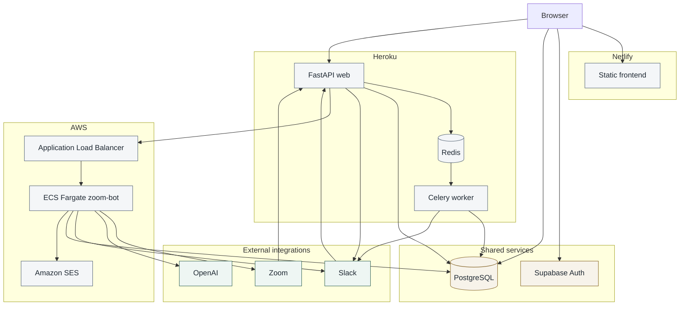

# System architecture

Runtime communication between the three applications, Supabase, and the external services. Deployment steps are in [../deployment.md](../deployment.md). Behavior and limitations are in [../architecture.md](../architecture.md).

## Who calls whom

| From | To | What happens |
| --- | --- | --- |
| Browser | Netlify | Loads HTML, CSS, and JavaScript. |
| Browser | Supabase Auth | Magic link and session. |
| Browser | PostgreSQL | Reads the user row, OAuth connection rows, and writes support messages through the Supabase client. |
| Browser | Heroku FastAPI | Starts Zoom and Slack OAuth and loads the recording list. |
| Zoom | Heroku FastAPI | OAuth callback and `recording.completed` webhook. |
| Slack | Heroku FastAPI | OAuth callback, button clicks, the settings command, and Events API calls. |
| Heroku FastAPI | Redis | Enqueues Celery tasks. |
| Redis | Celery worker | Delivers those tasks. |
| Celery worker | Slack and PostgreSQL | Sends the recording prompt and reads connection rows. |
| Heroku FastAPI | Slack | OAuth token exchange and message updates after a button click. |
| Heroku FastAPI | Application Load Balancer | `POST /api/zoom/webhook` after Process is clicked. |
| Load balancer | ECS Fargate | Forwards that request to the container on port 80. |
| ECS | Zoom | Downloads the cloud recording with a Server-to-Server token. |
| ECS | OpenAI | Whisper transcription and chat summary. |
| ECS | Slack | Posts the summary when `channel_id` is present. |
| ECS | PostgreSQL | Reads the host email and can write recording metadata from its own webhook helper. |
| ECS | Amazon SES | Sends the summary email. |

The Celery task that sends the Slack prompt builds an AWS payload and leaves the HTTP call commented out. A separate task, `tasks.process_recording_from_slack`, can post to AWS, and nothing in the HTTP handlers calls it.

There is no request path from the static site to AWS, and no request path from AWS back to Heroku.
