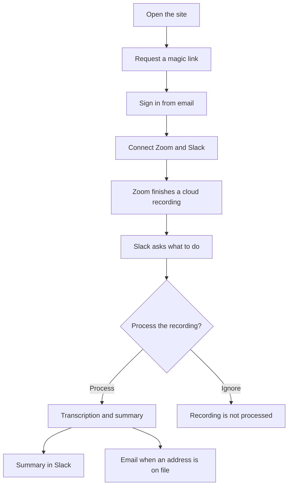

# User flow

This is the path a person follows from the first visit to a meeting summary. The technical path is in [system-architecture.md](system-architecture.md) and [../architecture.md](../architecture.md).

What each step does:

1. **Open the site.** The browser loads the static frontend.
2. **Request a magic link.** Supabase Auth emails a one-time sign-in link. There is no password form.
3. **Sign in from email.** The link returns the browser to the site and starts a session.
4. **Connect Zoom and Slack.** Each button sends the browser to the Heroku API, which completes OAuth and stores the tokens.
5. **Zoom finishes a cloud recording.** Zoom notifies Heroku. Heroku stores the recording when that Zoom host is already linked to a user.
6. **Slack asks what to do.** A direct message includes two buttons. Their labels are **Process** and **Ignore**.
7. **Process.** Heroku sends the stored download URL to AWS. AWS transcribes and summarizes the recording.
8. **Ignore.** Processing does not start. The button's action id is `ignore_recording`. The handler that rewrites the message looks for `ignore_meeting`, so the message is not updated with the ignore status.
9. **Summary in Slack.** Posted to the Slack channel that received the button click, when that channel id is present.
10. **Email.** Sent with Amazon SES when Supabase has an email for the Zoom host. The Slack "summaries" preference does not control this.
